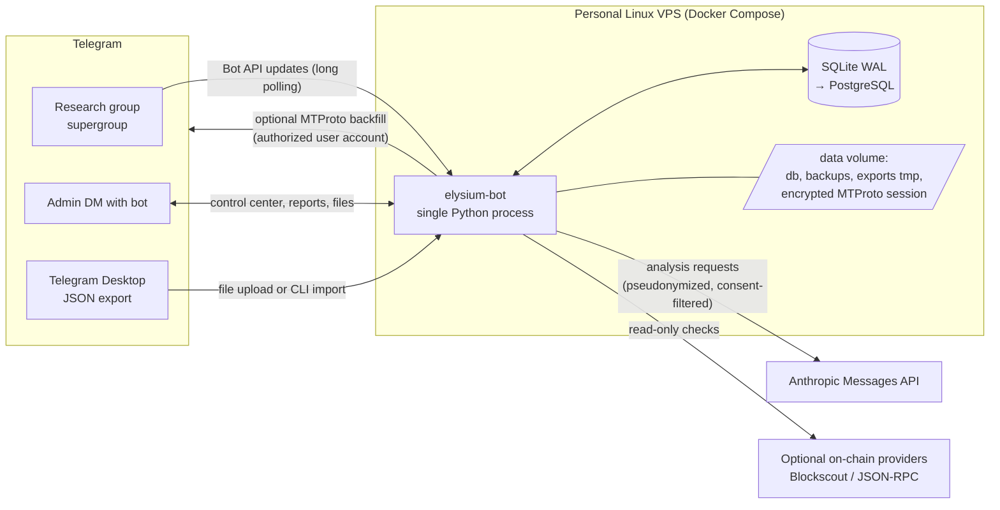
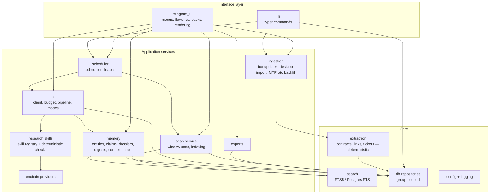
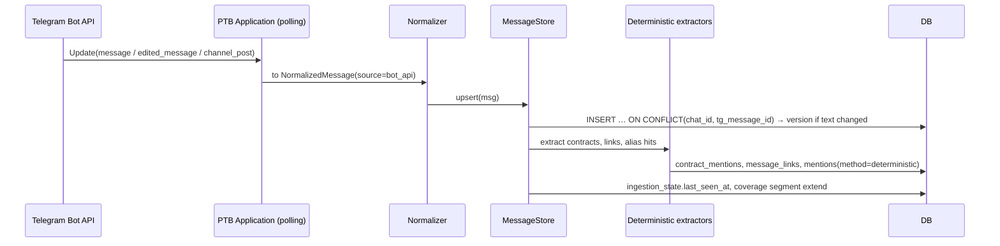
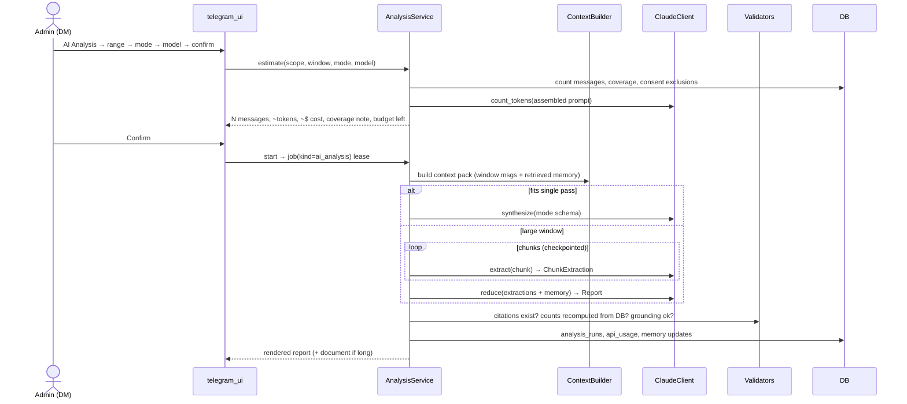

# Architecture — Elysium Early-Play Intelligence Bot

Status: **Approved baseline v1** (2026-11-01). Owner: architect (Claude Opus 5.5). Implementer: Claude Sonnet 5.5.
Changes to anything in this document require an ADR entry (§9) in the same PR.

## 1. Purpose

A Telegram bot that turns one or more research-focused Telegram groups (initially "Elysium Early Plays") into a **persistent, searchable, source-traceable research database**, and runs Claude-powered analysis on demand or on a schedule.

Priorities, in order — when two conflict, the higher one wins:

1. **Data completeness and provenance.** Know exactly which messages are stored, where they came from, and what is missing.
2. **Factual accuracy and source traceability.** Every derived statement must point at stored messages or a recorded external check.
3. **Zero-AI usefulness.** Collection, search, and raw export work without an Anthropic key or budget.
4. **Selectable Claude analysis** (Sonnet 5.5 for routine work, Opus 5.5 for deep research).
5. **Persistent research memory** across scan windows.
6. **Elysium-specific research skills.**
7. Polished Telegram UX.

Non-goals: trading, price prediction, buy/sell signals, wallet custody, and any form of automated on-chain action.

## 2. System context



## 3. Architectural style: a modular monolith

**Decision (ADR-001):** one Python 3.12 asyncio process, one database, one container. Modules are separated by package boundaries and interfaces, not by network hops.

Rationale: one developer, one VPS, low traffic (one group, a handful of admins). Microservices, message brokers, and separate workers would add operational cost without benefit. Long-running work (imports, large AI runs) runs as asyncio tasks inside the same process, with DB-backed job records so it can resume after a restart.

Escape hatch: the `jobs` table and `JobRunner` interface make it possible to move heavy jobs into a second container later (same image, `elysium-bot worker`) without schema changes.

## 4. Component view



### 4.1 Package layout (src layout)

```
src/elysium_bot/
  __main__.py          # `python -m elysium_bot` → cli.app
  cli.py               # typer: run, db upgrade, import-export, mtproto login|backfill, reindex, grant-role, healthcheck, backup
  config.py            # pydantic-settings Settings (env prefix ELYSIUM_)
  logging.py           # structlog JSON + secret redaction processor
  app.py               # composition root: builds services, PTB Application, scheduler
  timeutil.py          # UTC helpers, per-chat tz rendering (zoneinfo)
  db/
    base.py            # DeclarativeBase, UTCDateTime TypeDecorator, naming convention
    session.py         # async engine/session factory, SQLite pragmas (WAL, FK, busy_timeout)
    models/            # one module per bounded area (chats, messages, ingestion, jobs, ai, research, access)
    repositories/      # group-scoped query objects; no raw sessions in handlers
  migrations/          # alembic env + versions (dialect-aware FTS migration)
  ingestion/
    normalizer.py      # NormalizedMessage (pydantic) — the single internal message shape
    bot_updates.py     # Path A: PTB handlers → normalizer → MessageStore
    desktop_import.py  # Path B: streaming ijson parser → normalizer
    mtproto/           # Path C (optional extra): login, backfill, session crypto
    store.py           # MessageStore.upsert(): dedup, versioning, provenance
    coverage.py        # coverage segments, gap detection
  extraction/          # deterministic: contracts.py (EVM + EIP-55), links.py, tickers.py, aliases.py
  search/              # SearchIndex protocol; sqlite_fts.py; postgres_fts.py
  scan/                # ScanService: window stats, index refresh, checkpoints
  exports/             # writers (json/csv/txt/md), streaming, zip, coverage header
  ai/
    client.py          # ClaudeClient wrapper over AsyncAnthropic (models, effort, fallbacks, retries, usage)
    pricing.py budget.py estimate.py
    prompts/           # system prompt, untrusted-content wrapper, versioned templates
    schemas.py         # pydantic output models (structured outputs)
    pipeline/          # chunker, map (extract), reduce (synthesize), citation validator
    modes/             # summary, early_plays, deep_research, whats_changed, ask
    skill_registry.py  # loads repo-root skills/ into prompt modules + output schemas
  memory/              # entity_resolution, claims, timeline, dossiers, digests, context_builder
  onchain/             # OnchainProvider protocol, blockscout.py, rpc.py, check catalogue
  scheduler/           # schedule registry, job leases, misfire policy
  telegram_ui/         # router, callback codec, keyboards, calendar, flows/, render/, auth
  ops/                 # heartbeat, backup, retention purge
skills/                # version-controlled research skills (see BLOCKCHAIN_RESEARCH.md)
tests/                 # unit/, integration/, eval/ (+ fixtures/)
```

Rule: `telegram_ui` never touches SQLAlchemy sessions directly; it calls services. Services take a `ChatScope` (internal chat id + acting user + role), and repositories enforce that every query is filtered by chat (see SECURITY.md §5).

## 5. Key runtime flows

### 5.1 Live collection (Path A)



The store write happens before any other processing. Extraction failures are logged and retried by `reindex` and never block persistence.

### 5.2 On-demand AI analysis



### 5.3 Scheduled work

The scheduler (PTB `JobQueue`, backed by APScheduler) is **re-hydrated from the `schedules` table at startup**. Its in-memory store is never the source of truth. Each firing takes a DB lease on `(chat_id, job_family)`. If a lease is held and unexpired, the firing is skipped and the skip is recorded. Missed firings during downtime are coalesced into one run (`misfire: coalesce, run once`).

## 6. Technology decisions

| Concern | Choice | Notes |
|---|---|---|
| Runtime | Python 3.12, asyncio | `uv` for env + lockfile |
| Telegram bot | `python-telegram-bot[job-queue,rate-limiter]` 22.x (Bot API 10.0) | long polling; `AIORateLimiter` for the 20 msgs/min/group limit |
| MTProto (optional) | `telethon` 1.x (extra `mtproto`) | v1 is in maintenance mode but tracks API layers; isolated behind an interface |
| AI | `anthropic` Python SDK, `AsyncAnthropic` | Messages API only. No Claude Code CLI or subscription sessions at runtime |
| ORM / migrations | SQLAlchemy 2.0 async + Alembic | `aiosqlite` now, `asyncpg` later |
| DB | SQLite (WAL, FK on, `busy_timeout=5000`) | PostgreSQL path in DATABASE_DESIGN.md §9 |
| Search | SQLite FTS5 → PostgreSQL `tsvector` + GIN | behind a `SearchIndex` protocol; no vectors in MVP (AI_MEMORY §6) |
| Models / validation | Pydantic v2, pydantic-settings | Pydantic models double as Claude structured-output schemas |
| Large JSON import | `ijson` streaming | Telegram exports can be several GB |
| HTTP | `httpx` | on-chain providers |
| Crypto | `cryptography` (Fernet) for the MTProto session at rest; `pycryptodome` keccak for EIP-55 | |
| Logging | `structlog` JSON | redaction processor |
| CLI | `typer` | |
| Tests / lint | pytest, pytest-asyncio, time-machine, respx; Ruff (lint + format); mypy (strict on `ai/`, `ingestion/`, `memory/`) | |
| Packaging | Docker (python:3.12-slim, non-root), Compose, GitHub Actions | |

### 6.1 Claude API usage contract

This section is normative. `ai/client.py` is the only module that imports `anthropic`.

| Setting | Routine (summary, early plays, what's changed, ask, scheduled) | Deep research |
|---|---|---|
| Model | `claude-sonnet-5-5` | `claude-opus-5-5` |
| Thinking | `{"type": "adaptive"}` | `{"type": "adaptive"}` (cannot be disabled on Opus 5.5) |
| Effort (`output_config.effort`) | `medium` (set explicitly; Sonnet 5.5's default is `high`) | `high` (set explicitly; Opus 5.5's default is `medium`) |
| Output | Structured outputs: `client.messages.parse(..., output_format=PydanticModel)` | same |
| Streaming | Yes, for any request with `max_tokens` > 16k; use `.get_final_message()` | Yes |
| Refusal fallback | `fallbacks: "default"` with beta `server-side-fallback-2026-07-01` via `client.beta.messages` (config flag, default on) | same |

Hard rules, from current API behaviour as of 2026-10:

- Do not send `temperature`, `top_p`, or `top_k`. Since 2026-10-21 they return HTTP 400.
- Do not send `budget_tokens` or `thinking: {"type": "disabled"}`. Both return 400 on these models.
- No assistant prefill (400). Use structured outputs for format control.
- No forced `tool_choice` (`any`/`tool` return 400). Use `auto`, strict tools, and structured outputs.
- Always check `stop_reason` before reading content. Handle `refusal` (log `stop_details.category`, show the user a neutral message) and `max_tokens` (retry with a larger cap or smaller chunk).
- Log `response._request_id` and the full `usage` (input, output, cache read, cache write) for every call into `api_usage`.
- Model IDs, prices, and effort defaults live in config (`ai/pricing.py` defaults + `ELYSIUM_PRICING_OVERRIDES_JSON`) so a model or price change needs no code change. Default prices (USD/MTok, verify before release): Sonnet 5.5 $2 in / $10 out / $0.20 cache read; Opus 5.5 $4 / $20 / $0.20.
- Prompt caching: system prompt and skill modules come first and are stable byte-for-byte (no timestamps). Volatile content (window, question) comes after the last cache breakpoint. Verify with `usage.cache_read_input_tokens`.
- Untrusted content (Telegram messages) only goes in `user` turns, inside the untrusted wrapper (SECURITY.md §7). Operator-level instructions never come from chat data.

**Decision (ADR-004): Anthropic "Agent Skills" (container skills) are not used at runtime.** They require the code-execution container, add cost and latency, and send group data into a sandbox we don't need. Research skills are version-controlled prompt modules plus deterministic Python checks, assembled by `skill_registry.py` (BLOCKCHAIN_RESEARCH.md §2). Skill files use a `SKILL.md` layout so they could be uploaded later if needed. Installing Claude Code skills on a developer machine has **no effect** on the deployed bot.

## 7. Cross-cutting concerns

- **Time:** store UTC-aware datetimes (custom `UTCDateTime` type, which rejects naive values). Render in the chat's timezone (default `Asia/Ho_Chi_Minh`). Every displayed window shows both the start and end timestamps, with a tz label.
- **Identifiers:** internal integer PKs everywhere. Telegram IDs are stored as `BIGINT` (`tg_chat_id` in Bot API form, `-100…` for supergroups). Message references in AI prompts use `M<tg_message_id>` (unique per supergroup).
- **Idempotency:** every ingestion path is idempotent (upsert on natural keys). Every job is resumable from checkpoints.
- **Configuration:** `Settings` (env) for deployment-level values. `chat_settings` (DB) for per-group runtime values editable from Telegram. Settings in the DB win where both exist, within limits set by env (for example, a per-chat daily budget can't exceed `ELYSIUM_AI_DAILY_BUDGET_CAP_USD`).
- **Observability:** structured logs with `chat_id`, `job_id`, `analysis_run_id`, and `request_id`; a `heartbeats` row updated by the polling loop and scheduler; `elysium-bot healthcheck` used by the Docker HEALTHCHECK; a `/status` screen in Telegram.
- **Failure isolation:** if the Anthropic API is unavailable, ingestion, search, and export are unaffected. If on-chain providers are down, checks return `unavailable`. If Telegram polling disconnects, PTB retries and the outage window is recorded as a suspected coverage gap if it exceeds 24 h (see HISTORY_INGESTION.md §6).

## 8. Deployment topology

- `docker-compose.yml`: service `bot` (image `ghcr.io/nhattruong0204/elysium-scannor-bot`), with volume `./data:/data`, `env_file: .env`, `restart: unless-stopped`, a healthcheck, and log rotation (`json-file`, max-size 10m, max-file 5).
- Optional profile `postgres` adds a `db` service for the PostgreSQL migration.
- Migrations run at startup (`elysium-bot db upgrade` in the entrypoint, behind a file lock), or manually.
- Backups: nightly SQLite online backup to `/data/backups/` with 14-day rotation. Off-host copy is the operator's responsibility (SECURITY.md §11).

## 9. Architecture decision records

| ID | Decision | Alternatives considered | Trade-off accepted |
|---|---|---|---|
| ADR-001 | Modular monolith, single process | Bot + worker + queue (Redis/Celery) | Heavy jobs share the event loop. Mitigated by chunked async work and `asyncio.to_thread` for CPU-bound parsing |
| ADR-002 | SQLite first, PostgreSQL-ready | Postgres from day 1 | Single writer. Fine at this scale; WAL plus short transactions. Portability enforced by a Postgres migration job in CI |
| ADR-003 | Long polling, not webhooks | Webhook + TLS reverse proxy | Slightly higher latency. No domain/TLS needed on the VPS |
| ADR-004 | Prompt-module skills, not Anthropic container Skills | Agent Skills API with code execution | Lose sandboxed code execution, which we don't need. Keep cost, latency, and data flow minimal |
| ADR-005 | Lexical FTS + entity/alias index first; vector search deferred | Embeddings (Voyage) + sqlite-vec/pgvector | Weaker fuzzy semantic recall. Crypto names and tickers are lexical, and an alias table handles most recall. Revisit after evals |
| ADR-006 | Map-reduce with checkpointed chunks plus hierarchical digests | Stuff the 1M context | A 1M context still costs per token and degrades attribution. Chunks are resumable and auditable |
| ADR-007 | Telegram Desktop export as the primary history path; MTProto optional and off by default | MTProto as the primary path | Manual export step. Avoids account-ban and ToS exposure from automated user-account access |
| ADR-008 | Per-member AI consent gate, `strict` by default | Group notice only | Messages from non-consenting members are withheld from AI analysis. This follows Telegram's Content Licensing & AI terms (SECURITY.md §3) |
| ADR-009 | Pseudonymous sender labels in prompts (`U12`), mapped back locally | Real names in prompts | The model can't mis-spell names. Less personal data goes to the API. Name-based injection is harder |
| ADR-010 | Bot-owned citation IDs (`M<id>`) validated after generation | API `citations` feature | API citations are incompatible with structured outputs. Our validator also catches invented IDs |
| ADR-011 | Model never sets "verified/official" status | Let the model classify verification | Verification needs recorded evidence: an official-source registry, an admin action, or an on-chain check result |
| ADR-012 | Control center in the admin's DM; group receives only scheduled summaries (configurable) | Full UI in the group | Prevents leaking exports and settings to members and keeps the group quiet |

## 10. Credential and capability matrix

| Capability | Requires | Works without it? |
|---|---|---|
| Live collection | Bot token (BotFather), bot added to group, **privacy mode disabled** or bot is admin | — |
| Control center | Bot token, owner IDs in `ELYSIUM_OWNER_USER_IDS` | — |
| History import (Desktop export) | Export produced by a group member with Telegram Desktop | yes |
| MTProto backfill | `api_id`/`api_hash` (my.telegram.org), interactive login of an authorized member account, `ELYSIUM_MTPROTO_SESSION_KEY` | yes (disabled) |
| Raw export / search / scan | nothing beyond the bot | yes |
| AI analysis | `ANTHROPIC_API_KEY`, budget > 0, consenting members | ingestion/export unaffected |
| On-chain checks | Blockscout/RPC endpoints (some need provider API keys) | checks report `unavailable` |
| Web verification (optional, Phase 8) | Anthropic web search enabled on the org | reports say "no external lookup performed" |
| CI image publish | GitHub Actions with `packages: write` | — |
| Production deploy | VPS with Docker; SSH access | — |
