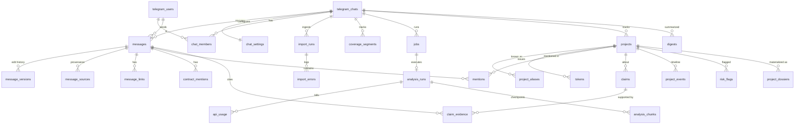

# Database Design

Status: **Approved baseline v1**. Engine: SQLite 3.40+ (WAL) via SQLAlchemy 2.0 async + Alembic. Target portability: PostgreSQL 16+.

## 1. Principles

1. **Raw evidence is immutable-ish.** Messages are upserted, never silently overwritten. Text edits create a `message_versions` row, and deletions are soft (`is_deleted`, `deleted_at`).
2. **Derived data is rebuildable.** Everything in Layers 2–4 (AI_MEMORY_ARCHITECTURE.md) records the `analysis_run_id` / `prompt_version` that produced it and can be regenerated from Layer 1.
3. **Every row belongs to a chat.** Research tables carry `chat_id` (directly or through a parent), and repositories refuse unscoped queries.
4. **UTC everywhere.** Use the `UTCDateTime` TypeDecorator. Naive datetimes raise.
5. **Portable types only:** `BigInteger`, `String`, `Text`, `Boolean`, `UTCDateTime`, `JSON` (SQLAlchemy generic), `Numeric(12,6)` for money. Enums are `String` + `CHECK`, with `native_enum=False`. The only dialect-specific DDL is the FTS migration, which branches on `op.get_bind().dialect.name`.
6. **Naming convention** set on `MetaData` (`ix_%(table)s_%(column_0_name)s`, `uq_…`, `fk_…`, `ck_…`) so Alembic autogenerate is stable on both dialects.
7. **SQLite pragmas on every connection:** `journal_mode=WAL`, `foreign_keys=ON`, `busy_timeout=5000`, `synchronous=NORMAL`.

## 2. Entity overview

## 3. Layer 1 — Raw evidence (migration owner: Phase 1 creates, Phase 2 extends)

### `telegram_chats`
| column | type | notes |
|---|---|---|
| id | int PK | internal |
| tg_chat_id | bigint UNIQUE | Bot API form (`-100xxxxxxxxxx` for supergroups) |
| type | str | `supergroup` \| `group` \| `channel` |
| title, username | str | latest seen |
| is_forum | bool | topics enabled |
| migrated_from_tg_chat_id | bigint null | basic group → supergroup migration |
| status | str | `pending` \| `active` \| `paused` \| `deactivated` |
| activated_at, activated_by_user_id | | |
| notice_posted_at, notice_message_id | | participant notice (SECURITY.md §3) |
| created_at, updated_at | | |

### `chat_settings` (1:1 with chat)
`chat_id` PK/FK, `timezone` (default `Asia/Ho_Chi_Minh`), `routine_model`, `routine_effort`, `deep_model`, `deep_effort`, `collection_interval_min` (null = disabled), `summary_interval_min` (null \| 60 \| 120 \| 180 \| 240), `summary_mode` (default `conversation_summary`), `summary_min_messages` (default 20), `summary_destination` (`group` \| `owner_dm` \| specific `tg_chat_id`), `daily_ai_budget_usd`, `retention_days` (null = keep forever), `ai_consent_policy` (`strict` \| `notice_only`), `pseudonymize_exports` (bool), `send_display_names_to_ai` (bool, default false), `updated_by_user_id`, `updated_at`.

### `telegram_users`
`id` PK, `tg_user_id` bigint UNIQUE, `username`, `first_name`, `last_name`, `is_bot`, `first_seen_at`, `last_seen_at`.
Senders that are channels (anonymous admins, linked channels) are stored with `sender_chat_tg_id` on the message, not as users.

### `chat_members`
`(chat_id, user_id)` PK, `pseudonym` (stable `U<n>` per chat, assigned on first sight), `ai_consent` (`unknown` \| `granted` \| `revoked`), `ai_consent_at`, `excluded` (bool: hard opt-out, which also applies to exports if `pseudonymize`), `purged_at`.

### `messages`
| column | type | notes |
|---|---|---|
| id | int PK | |
| chat_id | FK | |
| tg_message_id | bigint | per-chat ID (stable across Bot API / MTProto / export for supergroups) |
| message_thread_id | bigint null | forum topic / thread root |
| sender_user_id | FK null | |
| sender_chat_tg_id | bigint null | channel/anonymous admin sender |
| sender_name_snapshot | str | display name at send time |
| sent_at | UTCDateTime | from `date` / `date_unixtime` |
| edited_at | UTCDateTime null | latest edit |
| text | Text | plain text (caption for media) |
| entities | JSON null | normalized entities: `[{type, offset, length, url?}]` |
| reply_to_tg_message_id | bigint null | |
| forward_origin | JSON null | `{type, name, tg_chat_id?, tg_message_id?, date}` |
| media_type | str null | `photo` \| `video` \| `document` \| `sticker` \| `voice` \| `poll` \| … (media files are **not** downloaded) |
| media_meta | JSON null | filename, mime, duration, poll question/options |
| is_service | bool | joins, pins, title changes |
| service_action | str null | |
| is_deleted | bool, `deleted_at` | soft delete (MTProto-detected or admin purge) |
| content_hash | str(64) | sha256 of normalized text + media signature, used for basic-group fingerprinting |
| first_ingested_at, last_ingested_at | | |
| primary_source | str | first source that wrote it |
| index_state | str | `pending` \| `indexed` \| `failed`, for deterministic extraction + FTS |

Constraints and indexes: `UNIQUE(chat_id, tg_message_id)`; `ix(chat_id, sent_at)`; `ix(chat_id, sender_user_id, sent_at)`; `ix(chat_id, reply_to_tg_message_id)`; `ix(chat_id, message_thread_id, sent_at)`; partial `ix(chat_id) WHERE index_state='pending'`.

Basic groups are not first class because their message IDs differ between users. When `type='group'`, the store keys on `(chat_id, sender, sent_at, content_hash)` as a fallback (HISTORY_INGESTION.md §5.3), and the UI recommends converting to a supergroup.

### `message_versions`
`id`, `message_id` FK, `version_no`, `text`, `entities`, `edited_at`, `source`, `captured_at`. A version is written only when normalized text or entities differ from the current row. Version 1 is the first-seen text.

### `message_sources`
`(message_id, source)` PK, plus `import_run_id` null, `first_seen_at`, `last_seen_at`. Sources: `bot_api`, `desktop_export`, `mtproto`. This answers "which ingestion paths saw this message".

### `message_links`
`id`, `message_id`, `url`, `domain`, `kind` (`website` \| `x` \| `telegram` \| `docs` \| `github` \| `explorer` \| `dex` \| `other`), `position`.

### `contract_mentions`
`id`, `message_id`, `raw`, `normalized` (lowercase hex for EVM), `format` (`evm` \| `base58_like` \| `other`), `checksum_state` (`valid_checksum` \| `all_lower_or_upper` \| `invalid_checksum`), `position`. **This is not a verification.** Exports label it "extracted string".

### `messages_fts` (search index)
- SQLite: FTS5 virtual table `messages_fts(text, content='messages', content_rowid='id', tokenize="unicode61 remove_diacritics 2 tokenchars '$_'")`, kept in sync by AFTER INSERT/UPDATE/DELETE triggers on `messages`. `tokenchars` keeps `$TICKER` and `snake_case` tokens whole.
- PostgreSQL: generated column `text_tsv tsvector GENERATED ALWAYS AS (to_tsvector('simple', coalesce(text,''))) STORED` + GIN index. Use the `simple` config, not `english`, because tickers and names must not be stemmed.

## 4. Ingestion and coverage (Phase 1 creates, Phase 2 uses)

### `import_runs`
`id`, `chat_id`, `source`, `status` (`running` \| `succeeded` \| `partial` \| `failed` \| `cancelled`), `file_name`, `file_sha256`, `file_bytes`, `started_at`, `finished_at`, `triggered_by_user_id`, counters `seen`, `inserted`, `updated`, `unchanged`, `skipped`, `failed`, `checkpoint` (JSON: last processed `tg_message_id` / byte offset / MTProto `offset_id`), `summary` (JSON: min/max `sent_at`, min/max id).
Index `(chat_id, file_sha256)`: re-importing the same file is allowed and idempotent, and the UI warns that it's a duplicate.

### `import_errors`
`id`, `import_run_id`, `record_ref` (e.g. `message id 1234` or JSON path), `error_code`, `detail`, `raw_excerpt` (≤ 2 KB, secrets redacted).

### `coverage_segments`
`id`, `chat_id`, `source`, `kind` (`observed` \| `gap_suspected` \| `gap_confirmed_empty`), `start_at`, `end_at`, `start_tg_message_id`, `end_tg_message_id`, `message_count`, `import_run_id` null, `note`, `updated_at`.
Overlapping `observed` segments are merged by `coverage.py`. The coverage report is computed from these plus ID-sequence gap analysis (HISTORY_INGESTION.md §6).

### `ingestion_state`
`(chat_id, source)` PK, `last_seen_at`, `last_tg_message_id`, `last_update_id` (bot_api), `cursor` (JSON), `status`, `last_error`, `updated_at`.

## 5. Jobs, scheduling, AI accounting (Phase 1 creates `jobs`, `schedules`, `heartbeats`; Phase 5 creates AI tables)

### `jobs`
`id`, `chat_id`, `kind` (`scan` \| `import` \| `mtproto_backfill` \| `reindex` \| `export` \| `ai_analysis` \| `scheduled_summary` \| `dossier_rebuild` \| `digest_build` \| `retention_purge`), `family` (lease key: `ingest` \| `ai` \| `export` \| `maintenance`), `status` (`queued` \| `running` \| `succeeded` \| `failed` \| `cancelled` \| `skipped`), `trigger` (`manual` \| `schedule` \| `startup_resume`), `requested_by_user_id`, `params` (JSON), `progress` (JSON: done/total/stage), `lease_owner`, `lease_expires_at`, `heartbeat_at`, `started_at`, `finished_at`, `error`, `result` (JSON).
**Overlap guard:** a partial unique index `UNIQUE(chat_id, family) WHERE status='running'` (supported by SQLite ≥ 3.8 and Postgres). On startup, jobs with expired leases are moved to `failed` with `error='lease_expired'`, and resumable kinds are re-queued with `trigger=startup_resume`.

### `schedules`
`id`, `chat_id`, `kind` (`collection` \| `ai_summary` \| `digest` \| `backup` \| `retention`), `interval_min`, `enabled`, `params` (JSON: mode, model, effort, min_messages, destination), `next_run_at`, `last_run_at`, `last_job_id`.

### `heartbeats`
`component` PK (`polling`, `scheduler`, `job_runner`), `beat_at`, `detail`.

### `scan_checkpoints` (Phase 4)
`(chat_id, tg_user_id)` PK, `last_scan_start`, `last_scan_end`, `last_scan_job_id`, `updated_at`. Backs "Since last scan". A null user row (`tg_user_id = 0`) holds the scheduler's checkpoint.

### `analysis_runs` (Phase 5)
`id`, `job_id`, `chat_id`, `requested_by_user_id`, `mode`, `model`, `effort`, `window_start`, `window_end`, `project_id` null (deep research), `question` null (ask), `messages_in_window`, `messages_sent`, `messages_withheld_consent`, `coverage_complete` (bool), `coverage_note`, `prompt_version`, `skill_versions` (JSON), `status`, `estimated_cost_usd`, `actual_cost_usd`, `report` (JSON, validated schema), `report_rendered_md` (Text), `validation` (JSON: dropped citations, grounding failures), `tools_used` (JSON, **derived from API response blocks**, not model text), `created_at`, `finished_at`.

### `analysis_chunks` (Phase 5)
`id`, `analysis_run_id`, `chunk_index`, `first_tg_message_id`, `last_tg_message_id`, `token_estimate`, `status`, `output` (JSON), `api_usage_id`. Used to resume large runs.

### `api_usage` (Phase 5)
`id`, `chat_id`, `user_id` null, `analysis_run_id` null, `purpose` (`estimate` \| `extract` \| `synthesize` \| `ask` \| `digest` \| `dossier`), `model`, `served_by_model` (fallback), `request_id`, `input_tokens`, `output_tokens`, `cache_read_tokens`, `cache_write_tokens`, `cost_usd` Numeric(12,6), `stop_reason`, `latency_ms`, `created_at`.
Budget check: `SUM(cost_usd) WHERE chat_id=? AND created_at >= start_of_day(chat tz)`.

## 6. Layers 2–4 — Research memory (Phase 6 creates; Phase 7 extends)

### `projects`
`id`, `chat_id`, `canonical_name`, `slug` UNIQUE per chat, `status` (`candidate` \| `tracked` \| `archived` \| `merged`), `merged_into_id`, `category` (free-form short label), `chain_hint`, `elysium_relation` (`native` \| `multichain` \| `unclear` \| `unrelated`), `claimed_description` (what members say it builds, labelled as claimed), `research_state` (`new` \| `watching` \| `researching` \| `deprioritized`), `first_mention_message_id`, `first_mentioned_at`, `last_mentioned_at`, `mention_count`, `distinct_mentioners` (materialized by `memory/`), `created_via` (`deterministic` \| `ai_extraction` \| `admin`), `created_at`, `updated_at`.
`first_mentioned_at` is computed from `mentions` joined to `messages`, never taken from model output.

### `project_aliases`
`id`, `project_id`, `chat_id`, `alias`, `alias_norm` (casefold, strip `$`, NFKC), `kind` (`name` \| `ticker` \| `x_handle` \| `tg_handle` \| `domain` \| `contract`), `source_message_id` null, `confidence` (`confirmed` \| `probable`), `created_via`.
`UNIQUE(chat_id, kind, alias_norm)` for `x_handle`, `tg_handle`, `domain`, `contract`. **Tickers and names are not unique**: collisions are expected and resolved by `entity_resolution.py`.

### `tokens`
`id`, `chat_id`, `project_id` null, `ticker`, `chain` (`elysium` \| `hyperevm` \| `hypercore` \| `ethereum` \| `unknown` …), `address_norm` null, `address_status` (`extracted` \| `format_valid` \| `exists_onchain` \| `verified_official` \| `flagged`), `status_evidence` (JSON: check ids, source URLs), `first_seen_message_id`, `updated_at`. `UNIQUE(chat_id, chain, address_norm)`.

### `project_links`
`id`, `project_id`, `url`, `kind`, `status` (`claimed_in_chat` \| `verified_official` \| `suspected_impersonation`), `source_message_id`, `verified_by` (`registry` \| `admin:<user_id>`), `verified_at`.

### `mentions`
`id`, `chat_id`, `message_id`, `project_id`, `token_id` null, `surface_text`, `method` (`contract` \| `alias_exact` \| `alias_fuzzy` \| `ai`), `confidence` (0–1), `analysis_run_id` null. `UNIQUE(message_id, project_id, method)`.

### `claims`
| column | notes |
|---|---|
| id, chat_id, project_id null | |
| claim_type | `launch_timing` \| `partnership` \| `tokenomics` \| `airdrop_points` \| `listing` \| `funding` \| `audit_security` \| `product_feature` \| `team` \| `valuation_price` \| `official_affiliation` \| `other` |
| statement | normalized one-sentence claim, attributed ("U12 claims …") |
| status | `unverified` \| `supported` \| `disputed` \| `contradicted` \| `confirmed_official` \| `retracted` \| `superseded` |
| first_claimed_message_id, first_claimed_at, claimant_user_id | |
| supersedes_claim_id | correction chain |
| last_status_change_at, status_reason | |
| created_by_run_id, prompt_version | |

The model may propose `supported` / `disputed` / `contradicted` / `retracted`, with citations. **Only `memory/claims.py` may set `confirmed_official`**, and only when a `claim_evidence` row of kind `official_source` or `onchain_check` exists (ADR-011).

### `claim_evidence`
`id`, `claim_id`, `message_id` null, `external_url` null, `onchain_check_id` null, `relation` (`asserts` \| `supports` \| `contradicts` \| `retracts` \| `corrects` \| `official_source` \| `onchain_check`), `note`, `added_by_run_id` null, `added_by_user_id` null, `created_at`.

### `project_events` (timeline)
`id`, `project_id`, `event_type` (`first_mention` \| `contract_shared` \| `announcement_claimed` \| `announcement_official` \| `testnet` \| `mainnet` \| `launch` \| `listing` \| `risk_flag` \| `status_change` \| `other`), `occurred_at`, `description`, `evidence_message_ids` (JSON), `is_confirmed` (bool, same rule as claims), `created_by_run_id`.

### `narratives` and `narrative_links`
`narratives(id, chat_id, name, description, first_seen_at, last_seen_at)`. `narrative_links(narrative_id, project_id null, message_id null)`.

### `research_items` (decisions, action items, open questions, observations)
`id`, `chat_id`, `project_id` null, `kind` (`decision` \| `action_item` \| `open_question` \| `observation` \| `dd_question` \| `next_step`), `text`, `status` (`open` \| `resolved` \| `dropped`), `owner_user_id` null, `source_message_ids` (JSON), `resolved_by_message_id` null, `created_by_run_id`, `created_at`, `updated_at`.

### `risk_flags`
`id`, `chat_id`, `project_id` null, `token_id` null, `flag_type` (see BLOCKCHAIN_RESEARCH.md §5 catalogue), `severity` (`info` \| `low` \| `medium` \| `high`), `status` (`open` \| `resolved` \| `check_unavailable`), `basis` (`onchain_check` \| `registry` \| `group_claim` \| `ai_observation`), `evidence` (JSON), `onchain_check_id` null, `created_at`, `updated_at`.

### `onchain_checks`
`id`, `chat_id`, `token_id`, `check_name`, `provider`, `status` (`pass` \| `warn` \| `fail` \| `unavailable` \| `error` \| `not_applicable`), `result` (JSON raw provider summary), `checked_at`, `expires_at`. Results are displayed with their `checked_at` age and never presented as live data.

### `project_dossiers` (Layer 3, materialized)
`id`, `project_id`, `version`, `content` (JSON, `ProjectDossier` schema), `built_from_run_id`, `source_watermark_message_id` (last message considered), `is_current`, `built_at`. Rebuilt when stale (a new mention, claim, or check after the watermark).

### `digests` (Layer 4, hierarchical)
`id`, `chat_id`, `level` (`hour` \| `day` \| `week`), `period_start`, `period_end`, `first_tg_message_id`, `last_tg_message_id`, `message_count`, `content` (JSON `Digest` schema with citations), `model`, `prompt_version`, `status` (`current` \| `stale`), `analysis_run_id`, `created_at`. `UNIQUE(chat_id, level, period_start)`. A digest becomes `stale` when late-arriving messages land in its period (for example, after an import).

## 7. Access control and UI state (Phase 1 creates; Phase 3 uses)

- `chat_roles`: `(chat_id, tg_user_id)` PK, `role` (`admin` \| `analyst` \| `viewer`), `granted_by`, `granted_at`. Owners come from env and are not stored here.
- `audit_log`: `id`, `chat_id` null, `actor_tg_user_id`, `action` (`export` \| `analysis` \| `ask` \| `settings_change` \| `role_change` \| `import` \| `activate` \| `deactivate` \| `purge_user` \| `delete_chat_data`), `params` (JSON, redacted), `created_at`. Append-only.
- `ui_flows`: `token` (str(10), PK), `tg_user_id`, `chat_id` null, `flow`, `state` (JSON), `expires_at`. Backs callback data that doesn't fit in 64 bytes (TELEGRAM_UX.md §3).

## 8. Retention and deletion

- `retention_days` per chat. The `retention_purge` job hard-deletes messages older than the cutoff, along with their versions, sources, links, contract mentions, and FTS rows. Derived rows keep `evidence_message_ids` but render "source purged".
- Member purge (`purge_user`): hard-delete that member's messages, set `chat_members.excluded=true`, and mark derived claims where they are the claimant as `claimant purged`.
- Chat deletion (`delete_chat_data`): owner-only, two-step confirmation, deletes everything for the chat. `audit_log` keeps a single row.

## 9. PostgreSQL migration path

1. CI runs `alembic upgrade head` against a Postgres service container from Phase 1 onward, so dialect drift fails early.
2. The FTS migration is dialect-branched (§3). `SearchIndex` has `SqliteFtsIndex` and `PostgresFtsIndex` implementations, selected by engine dialect.
3. Data move: `elysium-bot db copy --from sqlite:///… --to postgresql+asyncpg://…`. It copies table by table in FK order, with batched inserts and sequence reset, then verifies row counts and checksums (Phase 9).
4. Swap `ELYSIUM_DATABASE_URL`; no code change.
5. Indicators that it's time to move: write-lock contention (`database is locked` in logs), DB > 5 GB, more than one active chat with heavy imports, or a need for a separate worker container.

## 10. Migration ownership by phase

| Phase | Migration(s) |
|---|---|
| 1 | `0001_core`: chats, chat_settings, users, chat_members, messages, message_versions, message_sources, message_links, contract_mentions, import_runs, import_errors, coverage_segments, ingestion_state, jobs, schedules, heartbeats, chat_roles, audit_log, ui_flows; `0002_fts` |
| 4 | `0003_scan`: scan_checkpoints |
| 5 | `0004_ai`: analysis_runs, analysis_chunks, api_usage |
| 6 | `0005_memory`: projects, project_aliases, tokens, project_links, mentions, claims, claim_evidence, project_events, narratives, narrative_links, research_items, project_dossiers, digests |
| 7 | `0006_risk`: risk_flags, onchain_checks |

Columns may be added by later phases through new migrations. Existing migrations are never edited after merge.
