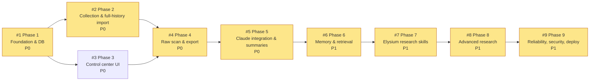

# Implementation Roadmap

Status: **Approved baseline v1** (2026-11-01). Backlog lives in GitHub Issues. This file explains the order and the why.

## 1. Phases and dependencies

**Critical path:** 1 → 2 → 4 → 5 → 6 → 7 → 8 → 9. Phase 3 can run in parallel with Phase 2 once Phase 1 is merged. Both must merge before Phase 4.

| Phase | Issue | Priority | Depends on | Milestone |
|---|---|---|---|---|
| 1 Foundation & DB | #1 | P0 | — | M1 MVP |
| 2 Collection & full-history import | #2 | P0 | #1 | M1 MVP |
| 3 Control center UI | #3 | P0 | #1 (soft: #2 for live counts) | M1 MVP |
| 4 Raw scan & export | #4 | P0 | #2, #3 | M1 MVP |
| 5 Claude integration & summaries | #5 | P0 | #4 | M1 MVP |
| 6 Memory & retrieval | #6 | P1 | #5 | M2 Research |
| 7 Elysium research skills | #7 | P1 | #6 | M2 Research |
| 8 Advanced research & Q&A | #8 | P1 | #7 | M2 Research |
| 9 Reliability, security, deployment | #9 | P1 | #8 (baseline hardening starts in #1) | M3 Production |

## 2. Milestones

- **M1 — MVP (Phases 1–5):** the bot collects live, imports full history, has a working control center, exports raw chat without AI, and runs selectable Sonnet/Opus summaries with cost controls. It can be deployed to the VPS from the end of Phase 1 (skeleton) and is usable from Phase 4.
- **M2 — Research intelligence (Phases 6–8):** persistent project memory, retrieval, Elysium skills, deep research, What's Changed, and Ask AI.
- **M3 — Production (Phase 9):** hardened, observable, backed up, documented, and Postgres-ready.

**Timing note:** Elysium mainnet is targeted for **2026-11-09** (announced, unconfirmed). Phases 1–2 plus the live collector should be deployed **before** that date, so launch-week discussion is captured live. History before deployment can be imported later from a Desktop export.

## 3. Scope tiers

### Required MVP (M1)
Live collection, Desktop export import, coverage tracking, control center with range picker, raw export (4 formats), scan stats, Claude summary and Early Plays modes, model/effort selection, cost estimate and budgets, scheduled summaries, consent gate, RBAC, Docker deploy, CI.

### Important production hardening (M2/M3)
MTProto backfill (Phase 2, optional flag), memory and dossiers, digests, skills and risk checks, Ask AI, What's Changed, backups, health monitoring, Postgres CI + copy tool, retention purge, security test suite, operational runbook.

### Future enhancements (not scheduled)
- **F-1** Local Bot API server for > 20 MB uploads via chat.
- **F-2** Webhook mode behind Caddy.
- **F-3** Embedding-based semantic retrieval (Voyage + sqlite-vec/pgvector), gated by eval recall and a consent review.
- **F-4** Transfer-simulation / honeypot provider integration once one supports Elysium.
- **F-5** DEX liquidity provider integration once Elysium mainnet indexers exist.
- **F-6** Multi-group dashboards and cross-group project linking (needs a separate consent analysis).
- **F-7** Message Batches API for bulk digest backfills.
- **F-8** Web dashboard (read-only).
- **F-9** Separate worker container for heavy jobs.

## 4. Delivery conventions
- One phase = one issue = one or more PRs (`phase-N/<slug>` branches). Large phases may land as several PRs, each referencing the issue with `Refs #N`. Only the final one uses `Closes #N`.
- A phase is **done** only when every acceptance criterion is verified and checked on the issue, CI is green, docs are updated, and the PR is merged after review.
- Architecture changes need an ADR row in ARCHITECTURE.md §9 and a note on the issue.
- Labels: `status:ready` (dependencies merged), `status:blocked` (waiting), `status:in-progress`, `status:review`. When a phase merges, the next phase's issue goes from `status:blocked` to `status:ready`.
